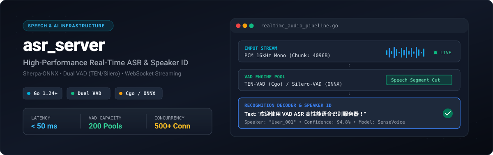
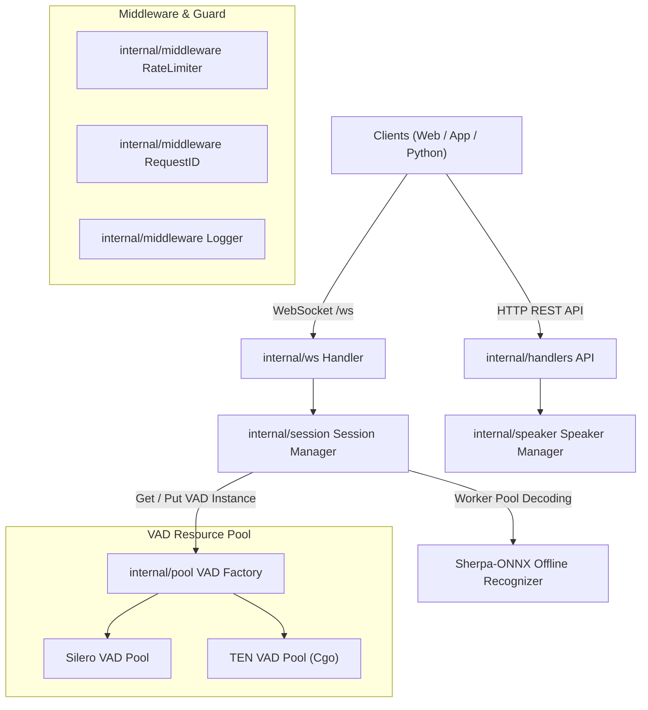

<div align="center">



# VAD ASR Server

**High-Performance Real-Time Speech Recognition & Speaker Verification Service**  
**基于 Sherpa-ONNX 的高性能实时语音识别与声纹识别服务器**

[](https://golang.org/)
[](https://github.com/k2-fsa/sherpa-onnx)
[](https://www.docker.com/)
[](LICENSE)
[](#key-features)

[English](#english) | [简体中文](#简体中文)

</div>

---

<a name="english"></a>
## English

### Key Features
- **Real-Time ASR Engine**: Low-latency multi-lingual speech-to-text powered by SenseVoice & Fun-ASR-Nano (supports Mandarin, English, Japanese, Korean, Cantonese, etc.).
- **Dual VAD Pipeline**: Integrates both **TEN-VAD** (high-efficiency Cgo endpoint detection) and **Silero-VAD** (ONNX-native) for intelligent silence filtering.
- **Speaker Verification (1:1 & 1:N)**: Native 3DSpeaker embedding extraction for speaker registration, identification, and verification.
- **Full-Duplex WebSocket Streaming**: Binary audio streaming with bounded Goroutine worker pools and zero-allocation buffer pooling.
- **Production Grade Reliability**: Graceful shutdown, dynamic logger/config hot-reloading (`viper` + `fsnotify`), per-IP rate limiting, and health monitoring endpoints.

---

### System Architecture



---

### Quick Start

#### Option 1: Docker Deployment (Recommended)
The container utilizes 8-bit quantized models and automatically downloads required weights on initial startup.

```bash
# 1. Build the Docker image
docker build -t asr_server .

# 2. Run the container
docker run -d -p 8088:8088 --name asr_server asr_server

# 3. (Optional) Check startup & automatic model download logs
docker logs -f asr_server
```

#### Service Endpoints:
- **Web Dashboard**: `http://localhost:8088/`
- **Health Check**: `http://localhost:8088/health`
- **WebSocket Streaming**: `ws://localhost:8088/ws`

---

#### Option 2: Local Development Setup

```bash
# 1. Grant script execution permissions
chmod +x dev.sh scripts/download_models.sh

# 2. Download model files (First time run)
./scripts/download_models.sh

# 3. Launch local development server
./dev.sh
```

For complete local development & Cgo library configuration, see [Local Development Guide](docs/LOCAL_DEVELOPMENT.md).

---

### Configuration Reference (`config.json`)

| Option | Description | Default |
| :--- | :--- | :--- |
| `server.port` | HTTP / WebSocket server port | `8088` |
| `vad.provider` | VAD Engine (`ten_vad` or `silero_vad`) | `ten_vad` |
| `vad.pool_size` | Capacity of pre-allocated VAD instance pool | `200` |
| `recognition.num_threads` | CPU threads for ASR model inference | `16` |
| `recognition.model_path` | Path to ONNX model file | `models/asr/sherpa-onnx-sense-voice-zh-en-ja-ko-yue-2024-07-17/model.int8.onnx` |
| `speaker.enabled` | Enable speaker verification module | `true` |

---

### WebSocket Client Example

```javascript
const ws = new WebSocket('ws://localhost:8088/ws');

ws.onopen = () => console.log('Connected to ASR Server');

ws.onmessage = (event) => {
    const data = JSON.parse(event.data);
    if (data.type === 'final') {
        console.log('Recognized Text:', data.text);
    }
};

// Send raw PCM 16kHz 16-bit mono audio binary data
ws.send(pcmAudioBuffer);
```

---

<a name="简体中文"></a>
## 简体中文

### 核心特性
- **实时语音识别**: 基于 SenseVoice 与 Fun-ASR-Nano 模型，支持中/英/日/韩/粤等多语种低延迟实时转写。
- **双 VAD 智能分级**: 内置 **TEN-VAD** (高效率 Cgo 端点检测) 与 **Silero-VAD** (ONNX 模式)，精准过滤静音段。
- **声纹识别 (Speaker ID)**: 集成 3DSpeaker 声纹特征提取，支持说话人注册、识别与 1:1 / 1:N 验证。
- **WebSocket 流式通信**: 全双工二进制音频流传输，搭配 Goroutine Worker Pool 实现高并发低延迟。
- **生产级特性**: 支持优雅关闭、配置文件动态热重载（`viper` + `fsnotify`）、令牌桶 IP 限流及全局健康度监控 API。

---

### 快速开始

#### 方式一：Docker 容器部署（推荐）

```bash
# 1. 构建镜像
docker build -t asr_server .

# 2. 启动容器
docker run -d -p 8088:8088 --name asr_server asr_server

# 3. (可选) 查看模型自动下载与服务启动日志
docker logs -f asr_server
```

#### 服务访问地址:
- **测试与管理 Web 页面**: `http://localhost:8088/`
- **服务健康度检查**: `http://localhost:8088/health`
- **WebSocket 实时音频流**: `ws://localhost:8088/ws`

---

#### 方式二：本地开发部署

```bash
# 1. 添加脚本执行权限
chmod +x dev.sh scripts/download_models.sh

# 2. 下载模型资源（首次运行）
./scripts/download_models.sh

# 3. 启动开发服务器
./dev.sh
```

更多本地环境依赖与 Cgo 动态库搭建参阅：[本地开发指南](docs/LOCAL_DEVELOPMENT.md)。

---

### 核心配置说明 (`config.json`)

```jsonc
{
  "server": {
    "port": 8088,
    "host": "0.0.0.0"
  },
  "vad": {
    "provider": "ten_vad", // 可选 "ten_vad" 或 "silero_vad"
    "pool_size": 200,
    "threshold": 0.5
  },
  "recognition": {
    "model_path": "models/asr/sherpa-onnx-sense-voice-zh-en-ja-ko-yue-2024-07-17/model.int8.onnx",
    "num_threads": 16
  },
  "speaker": {
    "enabled": true,
    "threshold": 0.6
  }
}
```

---

### 压测与测试脚本

项目在 `test/` 目录下提供了完整的 Python 压测与 API 测试工具：

```bash
# 并发压力测试 (100个并发连接)
python test/asr/stress_test.py --connections 100 --audio-per-connection 2

# 声纹识别 API 测试
python test/speaker/test_speaker_api.py
```

---

## License & Open-Source Agreements

This project core codebase is licensed under the **MIT License**.

All integrated models and engines comply with their respective open-source licenses:

- **SenseVoice Model**: Licensed under the [MIT License](https://github.com/FunAudioLLM/SenseVoice/blob/main/LICENSE) (Commercial-friendly).
- **Sherpa-ONNX Engine**: Licensed under the [Apache 2.0 License](https://github.com/k2-fsa/sherpa-onnx/blob/master/LICENSE).
- **Silero VAD Engine**: Licensed under the [MIT License](https://github.com/snakers4/silero-vad/blob/main/LICENSE).
- **3DSpeaker Model**: Licensed under the [Apache 2.0 License](https://github.com/alibaba-damo-academy/3D-Speaker/blob/main/LICENSE).
- **TEN-VAD Engine**: If enabled (`vad.provider: "ten_vad"`), please adhere to the [ten-vad Open Source License](https://github.com/ten-framework/ten-vad/blob/main/LICENSE)。

---

## Acknowledgements

- [Sherpa-ONNX](https://github.com/k2-fsa/sherpa-onnx) - Core Speech Recognition Engine
- [SenseVoice](https://github.com/FunAudioLLM/SenseVoice) - Multilingual Speech Model
- [Fun-ASR](https://github.com/alibaba-damo-academy/FunASR) - Lightweight End-to-End ASR Model
- [Silero VAD](https://github.com/snakers4/silero-vad) - Voice Activity Detector
- [ten-vad](https://github.com/zhenghuatan/ten-vad) - High-efficiency Endpoint Detection